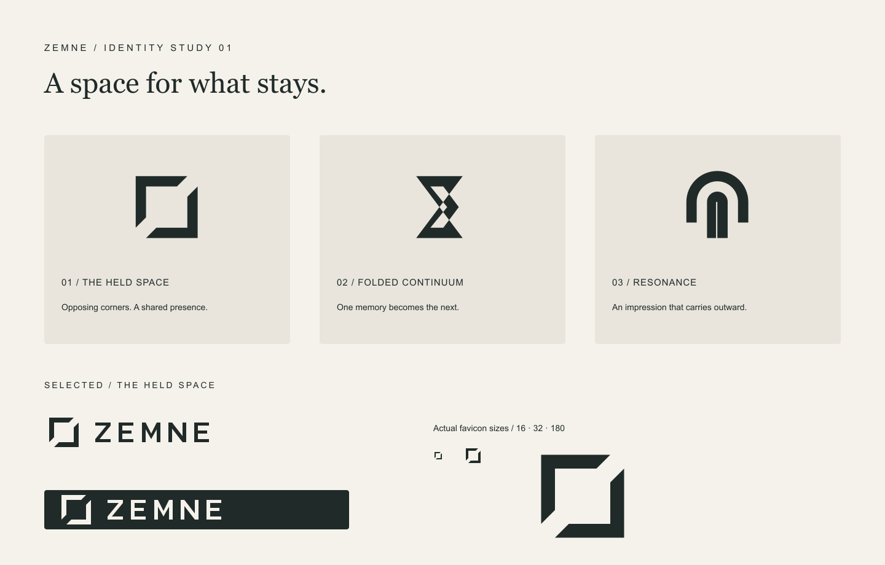

# ZEMNE — The Held Space

P2 creative selection, October 27, 2026. Owner visual approval and legal clearance remain separate gates.

## Idea

Two opposing open corners hold one shared space. They suggest both an architectural
threshold and a continuing connection without illustrating loss. The diagonal cuts
keep the frame open. The mark is quiet in one color before any interface treatment.

Three original vector directions were drawn on a 64-unit grid, then compared:

| Direction | Simplicity | Distinctiveness | 16px | App icon | Emotional fit | Decision |
| --- | --- | --- | --- | --- | --- | --- |
| The Held Space | Two corner ribbons | Clear open center and opposing cuts | Two separated corners survive | Strong square silhouette | A calm, protected shared space | Selected and refined |
| Folded Continuum | One angular ribbon | More expressive crossing | Crossing closes visually | Compact, but busy centrally | Can feel too mechanical/hourglass-like | Retained as exploration |
| Resonance | Nested arches | Softer, less distinctive | Interior gap becomes fragile | Softer vertical footprint | Architectural, but less ownable | Retained as exploration |

These are design judgments, not a trademark search or measured consumer study.
All three geometries are original to this implementation; no stock logo, generated
bitmap, downloaded illustration or existing brand reference was traced.

## Geometry and wordmark

- Master mark: 64 × 64 viewBox, 8-unit principal strokes and diagonal corner cuts.
- Minimum mark size: 16 CSS px; prefer 24 px or more in UI.
- Clear space: at least 8 master units (one stroke) on every side.
- The wordmark uses original outlined Z/E/M/N glyphs. It does not depend on a font,
  remains editable vector geometry and stays identical on every platform.
- Do not stretch, rotate, add shadows, use gradients inside the mark, fill the central
  void or place it over a visually complex image. Do not recolor individual ribbons.
- A 282 × 64 lockup aligns the mark and letter geometry; use the symbol alone for icons.

## Color and typography

| Role | Color | Use |
| --- | --- | --- |
| Ink | `#202B29` | Primary type, buttons, dark mark/background |
| Paper | `#F7F5EF` | Main interface surface |
| Mark ivory | `#F5F2EB` | Reversed logo and app icon |
| Muted green | `#59665D` | Supporting UI copy |
| Sage | `#E7EBE3` | Quiet surfaces and selected states |
| Brass | `#8B7045` | Fine details and focus outline, never essential color-only feedback |

Editorial headings use Georgia / Times New Roman / serif, with restrained italic
emphasis. UI labels and body text use Arial / Helvetica / sans-serif. These system
font stacks avoid external tracking requests, font downloads and undisclosed font
licensing. The custom SVG wordmark is independent of both stacks.

Spacing follows a 4px base, with 20–24px mobile gutters and 32–56px desktop gutters.
Primary controls are approximately 48–50px high; compact navigation controls remain
44px on mobile. Use text labels, visible focus, actual form labels and explicit
status/error messages. Reduced motion disables CSS transitions and snaps camera
changes. Decorative typography is not an interactive control.

## Deliverables

- `public/brand/zemne-logo-primary.svg`: full dark vector lockup.
- `public/brand/zemne-logo-dark.svg`, `zemne-logo-light.svg`: ink/ivory lockups.
- `public/brand/zemne-mark.svg`: separate symbol; `zemne-wordmark.svg`: lettering.
- `public/brand/concept-*.svg`: three retained original proposals.
- `public/brand/identity-study.svg` and `.png`: comparison contact sheet.
- `public/favicon.svg` and `.ico`: ivory mark on ink rounded-square field.
- `public/brand/icon-{16,32,180,192,512}.png`: actual-size PNG exports.
- Metadata includes SVG/ICO, Apple 180px icon and a 192/512px web manifest.
- `/identity` shows concepts, light/dark lockups and real 16/32/180px icon sizes.

Actual browser captures: `docs/evidence/p2/identity-desktop.png` and
`identity-mobile-390.png`. Inspect at 100% browser scale. The 16px icon retains two
distinct corners and its central opening. It is intentionally a symbol, not miniature
lettering. The small icon is not enlarged with CSS in the proof.

## Art and 3D provenance

`scripts/build-brand.mjs` contains the source geometry and exports the assets via
Sharp (provided by the installed Next.js dependency graph). It creates the PNGs and
the PNG-backed ICO from the same SVG; no image-generation service is involved.

`public/assets/neutral-1.svg`, `neutral-2.svg`, `neutral-3.svg` are original abstract
landscapes (Garden, Still water, Warm earth). They depict no person. They correspond
to P1's three `portrait_key` values. The hall portrait is an original canvas-drawn
version of the Garden composition. No real memorial portrait or testimonial is used.

The 3D colonnade, beams, floor, furniture, planters, portrait recess and memory-wall
plaque are procedural Three.js geometry in `src/3d/hall-scene.tsx`. No model files,
textures, HDRIs or third-party visual assets were imported. Numbered markers are
original canvas textures on interactive sprites attached to the three scene groups.

Dependency licenses remain upstream: React, Next.js, Tailwind, React Three Fiber,
Three.js and Sharp are MIT; TypeScript is Apache-2.0. Project license selection
still awaits owner approval; public visibility does not grant reuse rights.
